# GSAClientDiagnosticsToolkit

<p align="center">
  <a href="https://github.com/michaelmsonne/GSAClientDiagnosticsToolkit/releases/latest"></a>
  <a href="https://www.powershellgallery.com/packages/GSAClientDiagnosticsToolkit"></a>
  <a href="https://www.powershellgallery.com/packages/GSAClientDiagnosticsToolkit"></a>
  <a href="https://github.com/michaelmsonne/GSAClientDiagnosticsToolkit"></a>
  
  <a href="https://github.com/michaelmsonne/GSAClientDiagnosticsToolkit/issues"></a>
  <a href="https://github.com/michaelmsonne/GSAClientDiagnosticsToolkit/pulls"></a>
  <a href="https://github.com/michaelmsonne/GSAClientDiagnosticsToolkit"></a>
  <a href="https://github.com/michaelmsonne/GSAClientDiagnosticsToolkit"></a><br>
  <a href="https://learn.microsoft.com/powershell/"></a>
  <a href="https://learn.microsoft.com/windows/"></a>
  <a href="LICENSE"></a><br>
  <a href="https://www.linkedin.com/in/michaelmsonne/"></a>
  <a href="https://github.com/michaelmsonne/GSAClientDiagnosticsToolkit/stargazers"></a>
  <a href="https://github.com/michaelmsonne/GSAClientDiagnosticsToolkit/network/members"></a><br>
   <a href="https://www.buymeacoffee.com/sonnes" target="_blank"></a>
</p>

A PowerShell troubleshooting and diagnostics module for the **Microsoft Entra Global Secure Access (GSA) Windows client** (Entra Internet Access, Entra Private Access and Microsoft 365 traffic). It runs connectivity, proxy, DNS, TLS/mTLS, forwarding profile, Entra device/PRT, certificate and health probe checks to quickly find out why GSA isn't working on a device.

Showed a small teaser here to the community at 30 Aug. 2026: [LinkedIn](https://www.linkedin.com/feed/update/urn:li:activity:7499807681470464000/)

> [!IMPORTANT]
> Requires **PowerShell 5.1 or later**. Some checks must be run on a machine with the **Global Secure Access (GSA) Client** installed.

---

## Table of Contents

- [Overview](#overview)
- [Repository Structure](#repository-structure)
- [Requirements](#requirements)
- [Installation](#installation)
- [Importing the Module](#importing-the-module)
- [Quick Start](#quick-start)
- [Public Functions](#public-functions)
- [Log Levels](#log-levels)
- [Examples](#examples)
- [Star This Project](#star-this-project)
- [Support](#support)
- [Disclaimer](#disclaimer)

---

## Overview

`GSAClientDiagnosticsToolkit` automates end-to-end diagnostics for the Global Secure Access (GSA) Client on Windows. It covers:

- GSA Windows service health
- Entra ID device and PRT status
- Forwarding profile registry and timestamp validation
- Forwarding profile channel, edge, and diagnostic endpoint connectivity
- GSA mTLS authentication certificate validation, backup, and repair
- DNS resolution for GSA edge addresses
- TLS and mTLS connectivity to GSA endpoints
- Proxy detection (system proxy, transparent proxy, authenticating proxy)
- Secure DNS and IPv6 status
- Tenant Internet DNS Resolution detection (hosts-file and direct DNS comparison)
- Synthetic routes and private DNS resolver
- Cisco VPN split-DNS interoperability check for GSA NRPT/private DNS REFUSED scenarios
- Entra ID reachability
- GSA diagnostic URI connectivity
- Private Access rule, application segment, and tunnel validation
- GSA event log inspection
- Global Secure Access tenant, profile, user-assignment, and application configuration checks via Microsoft Graph
- Intelligent Local Access (ILA) Private Network configuration checks via Microsoft Graph

---

## Repository Structure

Outline of the repository's file contents, to help you navigate the codebase, tests, and related assets.

| File/folder | Description |
|---|---|
| `src/` | Module source code. |
| `src/GSAClientDiagnosticsToolkit.psd1` | Module manifest (metadata, exported functions). |
| `src/GSAClientDiagnosticsToolkit.psm1` | Root module file - dot-sources `Private`/`Public` and exports the public functions. |
| `src/Public/` | Exported public functions (one file per function, e.g. `Invoke-GSAClientConnectivityCheck.ps1`). |
| `src/Private/` | Internal helper functions used by the public functions, not exported. |
| `tests/` | Pester test suite, mirroring the `src/Public`/`src/Private` structure. |
| `docs/` | Reserved for additional documentation. |
| `CHANGELOG.md` | List of notable changes to the module. |
| `LICENSE` | The MIT license for this project. |
| `README.md` | This README file. |

---

## Requirements

| Requirement | Details |
|---|---|
| PowerShell | 5.1 or later |
| OS | Windows (GSA Client must be installed for some tests) |
| Elevation | Recommended - some checks (mTLS certificate access) require admin rights |
| Optional module | `MSAL.PS` - required only for `Test-EntraIDUserAuthentication` |
| Optional module | `Microsoft.Graph.Authentication` - required only for the Graph-based checks below when you don't supply `-AccessToken` yourself |

---

## Installation

### Option A - Install from the PowerShell Gallery (recommended)

```powershell
Install-Module -Name GSAClientDiagnosticsToolkit -Scope CurrentUser

# Pre-release versions
Install-Module -Name GSAClientDiagnosticsToolkit -Scope CurrentUser -AllowPrerelease
```

Then run `Invoke-GSAClientConnectivityCheck`. Module page: <https://www.powershellgallery.com/packages/GSAClientDiagnosticsToolkit>

### Option B - Clone and import locally

```powershell
git clone https://github.com/michaelmsonne/GSAClientDiagnosticsToolkit.git
Import-Module .\GSAClientDiagnosticsToolkit\src\GSAClientDiagnosticsToolkit.psd1
```

### Option C - Copy the folder to a module path

Copy the `GSAClientDiagnosticsToolkit` folder (the contents of `src`) to one of your `$env:PSModulePath` directories, for example:

```powershell
Copy-Item -Recurse .\GSAClientDiagnosticsToolkit\src `
    "$env:USERPROFILE\Documents\PowerShell\Modules\GSAClientDiagnosticsToolkit"
```

Then import it in any PowerShell session:

```powershell
Import-Module GSAClientDiagnosticsToolkit
```

---

## Importing the Module

```powershell
# From the cloned/downloaded folder
Import-Module .\GSAClientDiagnosticsToolkit.psd1

# Verify the module loaded and see all exported commands
Get-Command -Module GSAClientDiagnosticsToolkit
```

---

## Quick Start

Run the full diagnostic suite with default settings:

```powershell
Import-Module .\GSAClientDiagnosticsToolkit.psd1
Invoke-GSAClientConnectivityCheck
```

Run with verbose (DEBUG) logging and save the log to a custom path:

```powershell
Invoke-GSAClientConnectivityCheck -LogLevel DEBUG -BasePath C:\Logs
```

---

## Public Functions

> Most functions below also accept an optional `-LogLevel <string>` parameter (`ERROR`, `WARNING`, `INFO`, `DEBUG`, `SUCCESS`) that overrides the module's current logging verbosity for just that call.

### `Invoke-GSAClientConnectivityCheck`

Runs the complete diagnostic suite in sequence and produces a summary.

```powershell
Invoke-GSAClientConnectivityCheck [-LogLevel <string>] [-BasePath <string>] [-LogFileName <string>]
```

| Parameter | Default | Description |
|---|---|---|
| `LogLevel` | `INFO` | Verbosity: `ERROR`, `WARNING`, `INFO`, `DEBUG`, `SUCCESS` |
| `BasePath` | Current directory | Directory where the log file is written |
| `LogFileName` | `GSAClientDiagnosticsToolkit.log` | Name of the log file |

<details>
<summary>Sample output</summary>

```text
[2026-08-20 18:00:00] [INFO] ========= GSA Client Connectivity Checker v. 1.0.0 Started =========
[2026-08-20 18:00:00] [INFO] Device Name : CONTOSO-LAPTOP01
[2026-08-20 18:00:00] [INFO] User Account: user@contoso.com
[2026-08-20 18:00:01] [INFO] ===== Executing: GSA Service Status =========
[2026-08-20 18:00:01] [SUCCESS] ===== GSA Service Status : PASSED =========
[2026-08-20 18:00:01] [INFO] ===== Executing: Device Entra Status =========
[2026-08-20 18:00:02] [SUCCESS] ===== Device Entra Status : PASSED =========
...
[2026-08-20 18:00:12] [INFO] ========= GSA Client Connectivity Check Completed =========
[2026-08-20 18:00:12] [INFO] Summary: 17 tests passed, 0 tests failed, 0 tests with warnings.
[2026-08-20 18:00:12] [SUCCESS] All tests passed successfully!
```

</details>

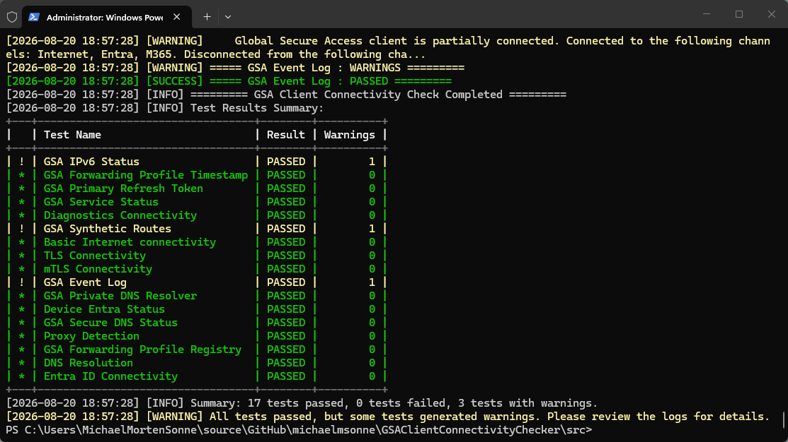

---

### `Get-GSAEndpoints`

Loads the GSA ForwardingProfile JSON from the registry and returns the list of edge addresses and diagnostic URIs.

```powershell
Get-GSAEndpoints [-RegistryValueName <string>]
```

<details>
<summary>Sample output</summary>

```text
[2026-08-20 18:01:00] [INFO] Successfully read JSON data from registry path: HKLM:\SOFTWARE\Microsoft\Global Secure Access Client
[2026-08-20 18:01:00] [INFO] Extracted 3 channel entries with endpoint data.
```

</details>

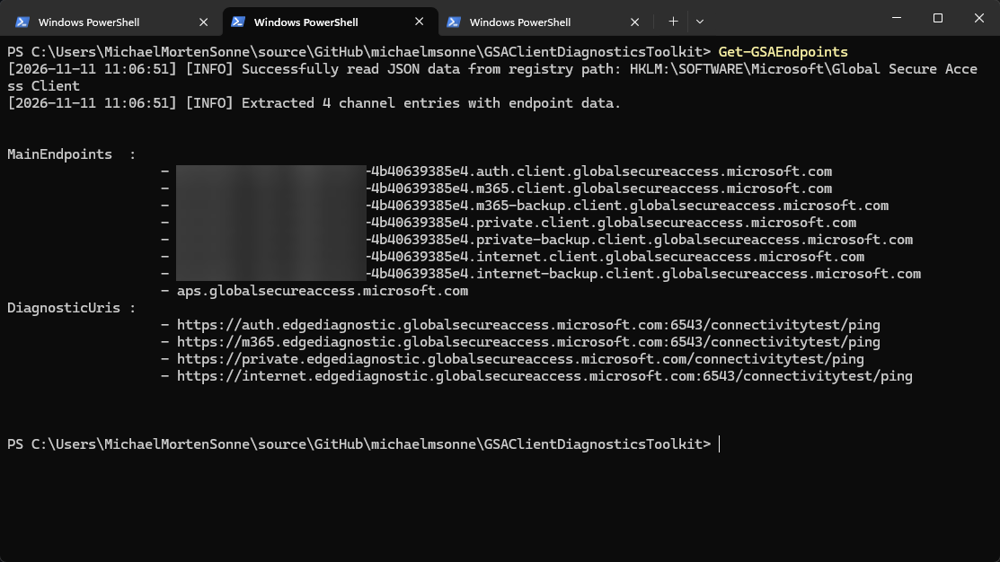

---

### `Get-GSAAppProtectionExclusionServicePrincipals`

Returns the known Global Secure Access-related service principals that can be excluded in App Protection policies.
By default, it validates each App ID against Microsoft Graph in the current tenant and writes a colored status line
per service principal (green = present/enabled, red = missing/disabled, yellow = other). Use `-PassThru` to also
return objects with fields such as `ExistsInTenant`, `CurrentState`, `TenantDisplayName`, and `DisplayNameMatches`.


```powershell
Get-GSAAppProtectionExclusionServicePrincipals
```

```powershell
Get-GSAAppProtectionExclusionServicePrincipals -PassThru | Format-Table DisplayName, AppId, ExistsInTenant, CurrentState
```

```powershell
Get-GSAAppProtectionExclusionServicePrincipals -ValidateInTenant:$false
```

<details>
<summary>Current entries</summary>

```text
Global Secure Access Client - cde6adac-58fd-4b78-8d6d-9beaf1b0d668
Internet resources with Global Secure Access - 5dc48733-b5df-475c-a49b-fa307ef00853
Microsoft apps with Global Secure Access - c08f52c9-8f03-4558-a0ea-9a4c878cf343
ZTNA Policy Service - b3fa0115-39b3-4bec-8cc6-8c4fcd33e69d
ZTNA Policy Service Client - ca01d00c-bfd6-46d6-ae7d-be5b5267d037
ZTNA Policy Service Graph Client - 3b80cd3f-61ca-49b0-8d0f-7b6760e08705
Global Secure Access Private Access Traffic Profile Resource Id - e92b9b37-1b47-4c01-9fbc-91d84450870e
ZTNA Data Acquisition - PROD - 7dd7250c-c317-4bc6-8528-8d27b02707ef
```

</details>

Info logs:

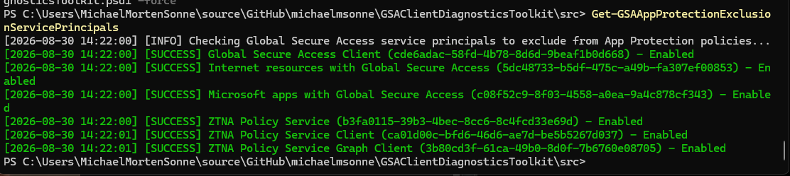

Debug logs:

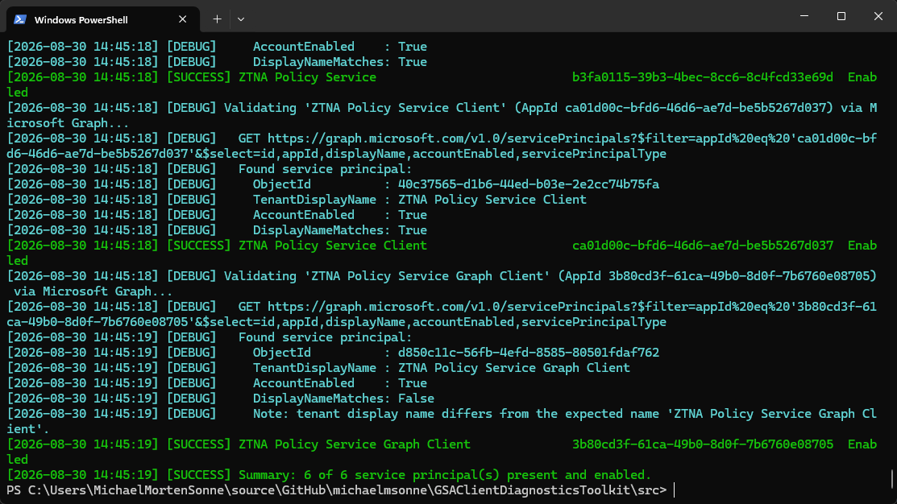

---

### `Export-GSAEdgeAddresses`

Saves a list of edge address FQDNs to a file.

```powershell
Export-GSAEdgeAddresses -fqdnList <string[]> -filePath <string>
```

<details>
<summary>Sample output</summary>

```text
[2026-08-20 18:02:00] [SUCCESS] Edge addresses saved to: C:\Temp\edges.txt
```

</details>

<!-- TODO: Add screenshot -->
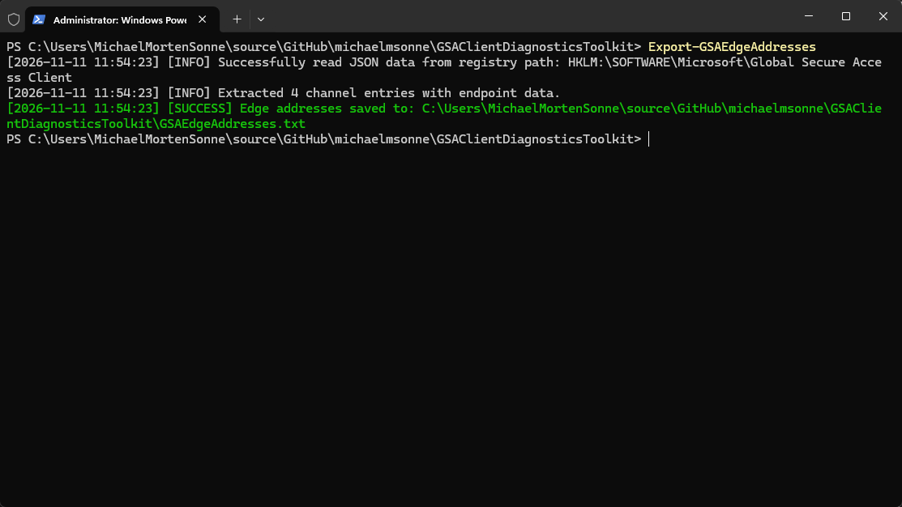

---

### `Test-GSAServiceStatus`

Verifies that all required Global Secure Access Windows services are in the **Running** state.

```powershell
Test-GSAServiceStatus [-LogLevel <string>]
```

Services checked: `GlobalSecureAccessTunnelingService`, `GlobalSecureAccessClientManagerService`, `GlobalSecureAccessEngineService`, `GlobalSecureAccessDriver`, and the forwarding profile service.

<details>
<summary>Sample output</summary>

```text
[2026-08-20 16:52:52] [SUCCESS] Global Secure Access Client installation found at: C:\Program Files\Global Secure Access Client
[2026-08-20 16:52:52] [INFO] Checking Tunneling Service (GlobalSecureAccessTunnelingService)...
[2026-08-20 16:52:52] [SUCCESS] Tunneling Service is running.
[2026-08-20 16:52:52] [INFO] Checking Client Manager Service (GlobalSecureAccessClientManagerService)...
[2026-08-20 16:52:52] [SUCCESS] Client Manager Service is running.
[2026-08-20 16:52:52] [INFO] Checking Engine Service (GlobalSecureAccessEngineService)...
[2026-08-20 16:52:52] [SUCCESS] Engine Service is running.
[2026-08-20 16:52:52] [INFO] Checking Driver Service (GlobalSecureAccessDriver)...
[2026-08-20 16:52:52] [SUCCESS] Driver Service is running.
[2026-08-20 16:52:52] [INFO] Checking Forwarding Profile Service...
[2026-08-20 16:52:52] [SUCCESS] Forwarding Profile Service is running.
```

</details>

<!-- TODO: Add screenshot -->
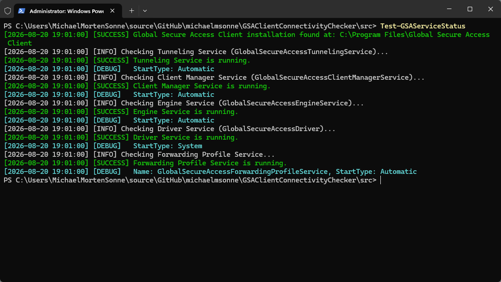

---

### `Test-DeviceEntraStatus`

Checks whether the device is Entra ID joined or registered.

```powershell
Test-DeviceEntraStatus [-LogLevel <string>]
```

<details>
<summary>Sample output</summary>

```text
[2026-08-20 16:52:52] [INFO] Checking if device is connected to Microsoft Entra ID...
[2026-08-20 16:52:52] [SUCCESS] Device 'CONTOSO-LAPTOP01' is connected to Microsoft Entra ID.
[2026-08-20 16:52:52] [INFO] Checking Private Access user-disable registry flag...
[2026-08-20 16:52:52] [SUCCESS] Private Access is enabled (IsPrivateAccessDisabledByUser is not set or is 0).
```

</details>

<!-- TODO: Add screenshot -->
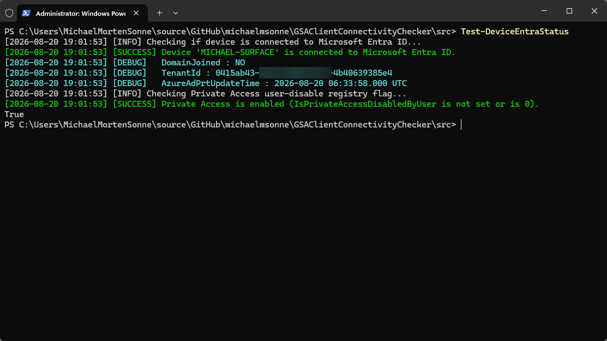

---

### `Test-GSAPrimaryRefreshToken`

Verifies that a valid Primary Refresh Token (PRT) is present on the device.

```powershell
Test-GSAPrimaryRefreshToken [-LogLevel <string>]
```

<details>
<summary>Sample output</summary>

```text
[2026-08-20 16:53:00] [INFO] Checking Primary Refresh Token (PRT) status via dsregcmd...
[2026-08-20 16:53:00] [SUCCESS] Primary Refresh Token (AzureAdPrt) is present - device can authenticate with Entra ID.
```

</details>

<!-- TODO: Add screenshot -->
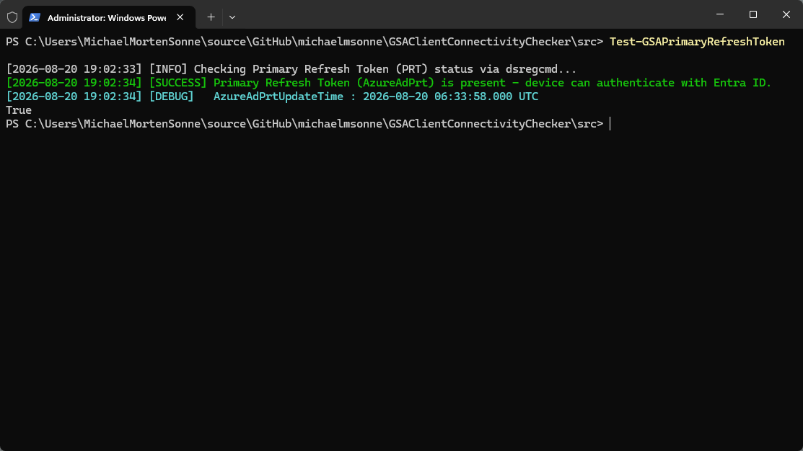

---

### `Test-GSAForwardingProfileRegistry`

Validates that the GSA forwarding profile exists and is readable from the registry.

```powershell
Test-GSAForwardingProfileRegistry [-LogLevel <string>]
```

<details>
<summary>Sample output</summary>

```text
[2026-08-20 16:54:00] [INFO] Checking ForwardingProfile registry key...
[2026-08-20 16:54:00] [SUCCESS] ForwardingProfile registry key exists.
[2026-08-20 16:54:00] [INFO] Checking ForwardingProfile registry value is not empty...
[2026-08-20 16:54:00] [SUCCESS] ForwardingProfile registry value is populated.
[2026-08-20 16:54:00] [INFO] Validating ForwardingProfile JSON...
[2026-08-20 16:54:00] [SUCCESS] ForwardingProfile JSON is valid. Configured channel(s): m365, private, internet.
```

</details>

<!-- TODO: Add screenshot -->
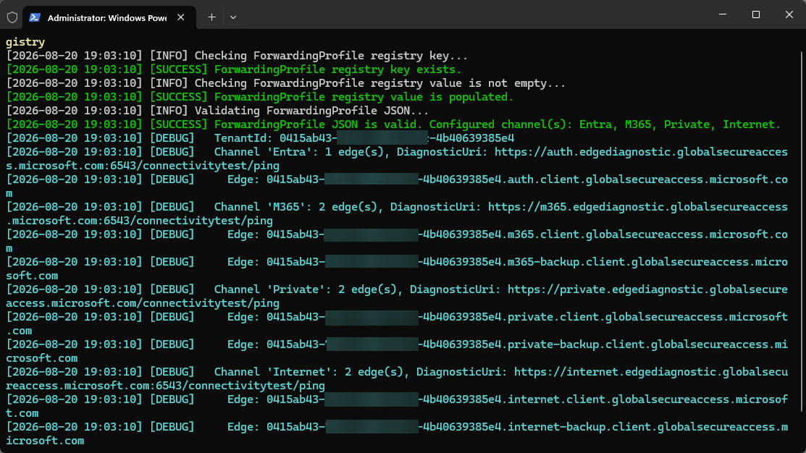

---

### `Test-GSAForwardingProfileTimestamp`

Checks the timestamp of the forwarding profile to detect stale configuration.

```powershell
Test-GSAForwardingProfileTimestamp [-LogLevel <string>]
```

<details>
<summary>Sample output</summary>

```text
[2026-08-20 16:55:00] [INFO] Checking ForwardingProfileTimestamp registry value...
[2026-08-20 16:55:00] [SUCCESS] ForwardingProfile was last retrieved 0h 12m ago (UTC: 2026-08-20 14:43:00Z) - profile is current.
```

</details>

<!-- TODO: Add screenshot -->
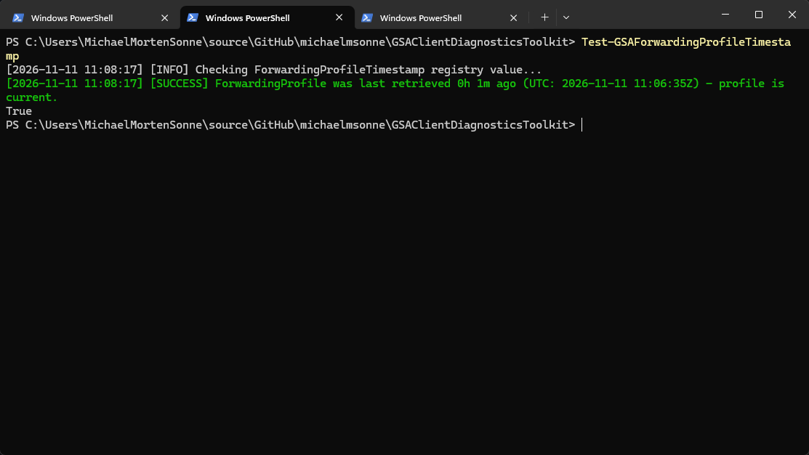

---

### `Test-InternetConnectivity`

Tests basic internet reachability and inspects active network interfaces with default routes.

```powershell
Test-InternetConnectivity [-Websites <string[]>] [-DnsServers <string[]>] [-TimeoutMs <int>] [-LogLevel <string>]
```

| Parameter | Default | Description |
|---|---|---|
| `Websites` | `www.google.com`, `www.microsoft.com` | Websites to test for reachability |
| `DnsServers` | `1.1.1.1`, `8.8.8.8`, `9.9.9.9` | DNS servers to test for reachability over UDP port 53 |
| `TimeoutMs` | `5000` | UDP receive timeout in milliseconds |

<details>
<summary>Sample output</summary>

```text
[2026-08-20 16:56:00] [INFO] Active network interfaces with default routes detected.
[2026-08-20 16:56:00] [INFO] Website www.google.com is reachable.
[2026-08-20 16:56:00] [INFO] Website www.microsoft.com is reachable.
[2026-08-20 16:56:01] [INFO] DNS server 1.1.1.1 is reachable on UDP port 53.
[2026-08-20 16:56:01] [INFO] DNS server 8.8.8.8 is reachable on UDP port 53.
[2026-08-20 16:56:01] [INFO] DNS server 9.9.9.9 is reachable on UDP port 53.
```

</details>

<!-- TODO: Add screenshot -->
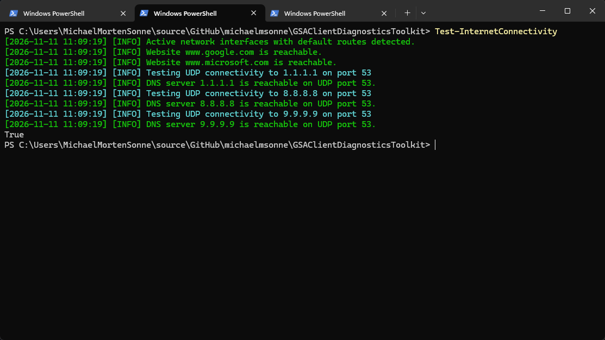

---

### `Test-ProxyDetection`

Detects outbound proxy configuration via system settings, transparent proxy HTTP headers, and HTTP 407 responses.

```powershell
Test-ProxyDetection [-TestUrlHttp <string>] [-TestUrlHttps <string>] [-TimeoutSec <int>] [-LogLevel <string>]
```

<details>
<summary>Sample output</summary>

```text
[2026-08-20 16:57:00] [INFO] System proxy is not configured (Direct access mode).
[2026-08-20 16:57:00] [INFO] NO grpc_proxy environment variables are set.
[2026-08-20 16:57:00] [INFO] SystemWebProxy: Direct connection will be used.
[2026-08-20 16:57:01] [INFO] HTTP test request to http://www.msftconnecttest.com/connecttest.txt succeeded.
[2026-08-20 16:57:01] [INFO] HTTPS test request to https://www.microsoft.com succeeded.
```

</details>

<!-- TODO: Add screenshot -->
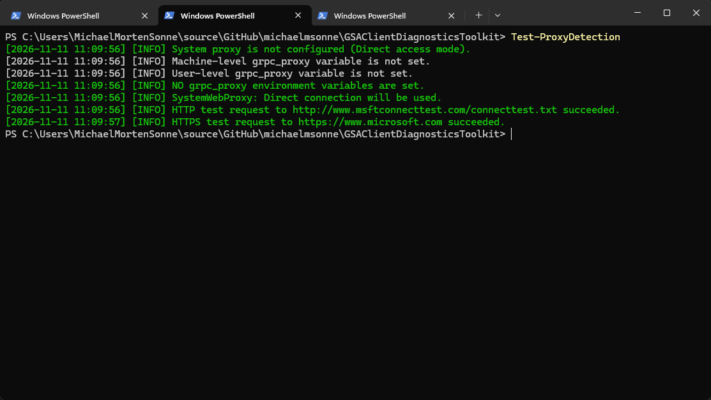

---

### `Test-GSASecureDnsStatus`

Checks whether the GSA Secure DNS feature is enabled and active.

```powershell
Test-GSASecureDnsStatus [-LogLevel <string>]
```

<details>
<summary>Sample output</summary>

```text
[2026-08-20 16:58:00] [INFO] Checking Secure DNS (DoH) policy settings - GSA requires DoH to be disabled...
[2026-08-20 16:58:00] [SUCCESS] Microsoft Edge: Secure DNS (DoH) is not enforced or is set to 'off'.
[2026-08-20 16:58:00] [SUCCESS] Google Chrome: Secure DNS (DoH) is not enforced or is set to 'off'.
```

</details>

<!-- TODO: Add screenshot -->
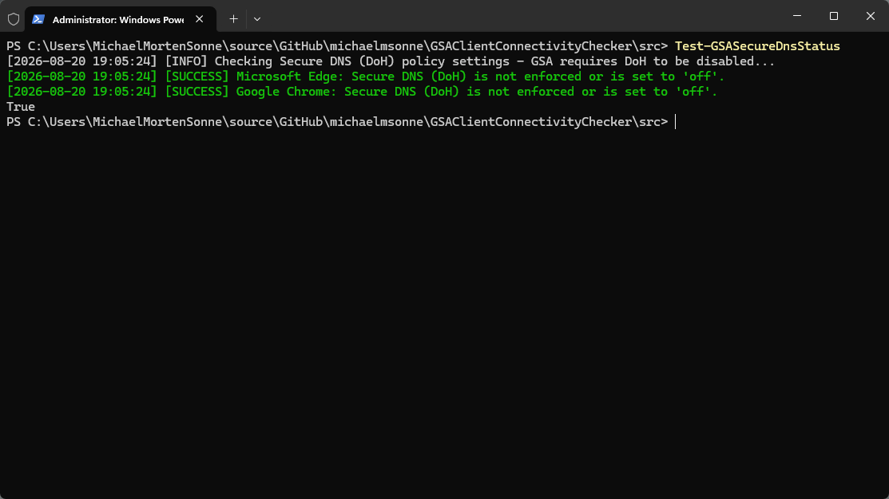

---

### `Test-GSAIPv6Status`

Reports the IPv6 status on the GSA tunnel adapter.

```powershell
Test-GSAIPv6Status [-LogLevel <string>]
```

<details>
<summary>Sample output</summary>

```text
[2026-08-20 16:59:00] [INFO] Checking IPv6 binding on active physical network adapters - GSA does not support IPv6...
[2026-08-20 16:59:00] [INFO] IPv6 is disabled on adapter 'Ethernet'.
[2026-08-20 16:59:00] [SUCCESS] IPv6 is disabled on all active physical adapters.
```

</details>

<!-- TODO: Add screenshot -->
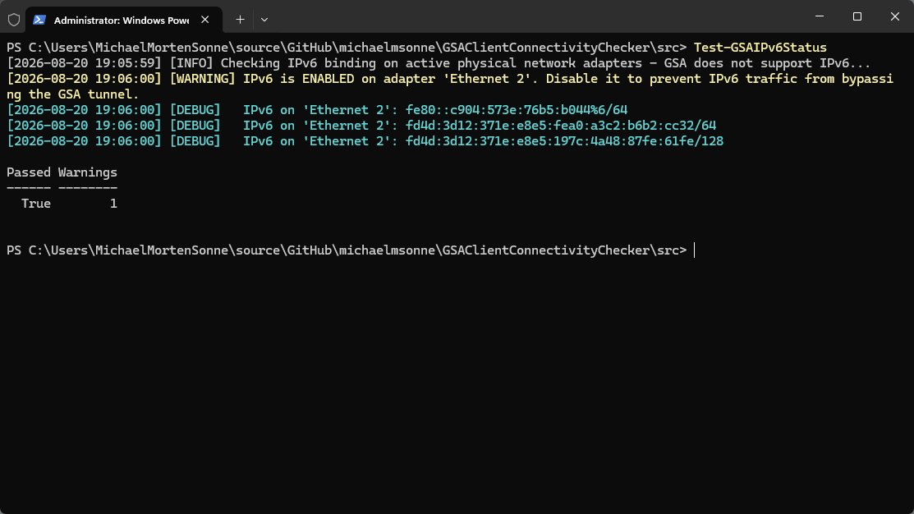

---

### `Test-GSAHomeNetworkSupport`

Checks whether [home network support](https://learn.microsoft.com/en-us/entra/global-secure-access/how-to-configure-home-network-support) (**Allow local subnet bypass** on the Private Access traffic forwarding profile) is enabled for this client, and flags local subnets that overlap Private Access destinations. Local/offline: it reads the forwarding profile the client received, no Graph call.

```powershell
Test-GSAHomeNetworkSupport [-RegistryValueName <string>] [-PassThru] [-LogLevel <string>]
```

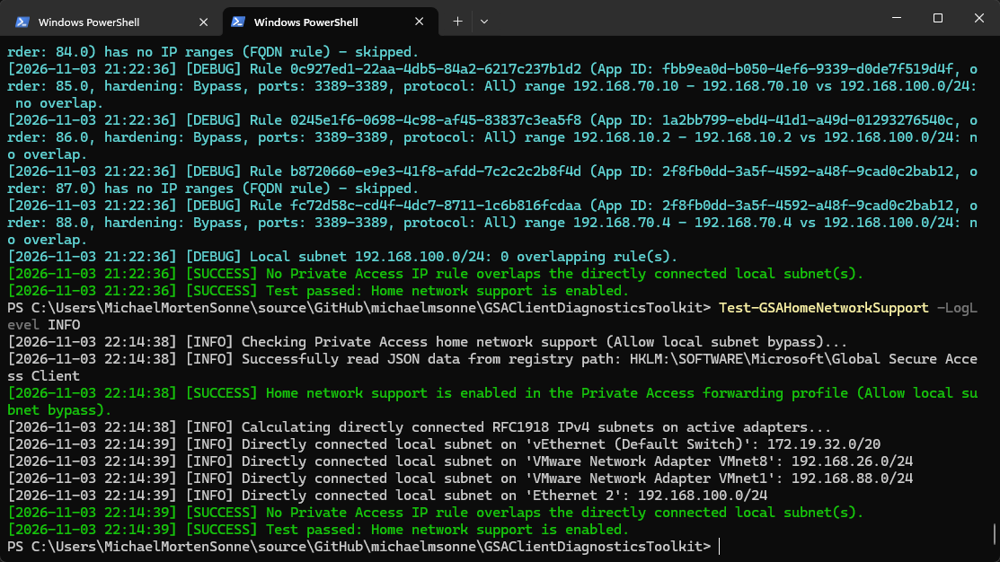

With `-PassThru` it returns `$false` when the Private Access channel is missing, the `localNetwork` setting is absent (unsupported client) or the setting is disabled. The per-user **Prefer Local Network** toggle isn't stored in the profile and can't be verified.

<details>
<summary>Sample output</summary>

```text
PS> Test-GSAHomeNetworkSupport -LogLevel INFO
[2026-11-03 22:14:38] [INFO] Checking Private Access home network support (Allow local subnet bypass)...
[2026-11-03 22:14:38] [INFO] Successfully read JSON data from registry path: HKLM:\SOFTWARE\Microsoft\Global Secure Access Client
[2026-11-03 22:14:38] [SUCCESS] Home network support is enabled in the Private Access forwarding profile (Allow local subnet bypass).
[2026-11-03 22:14:38] [INFO] Calculating directly connected RFC1918 IPv4 subnets on active adapters...
[2026-11-03 22:14:39] [INFO] Directly connected local subnet on 'vEthernet (Default Switch)': 172.19.32.0/20
[2026-11-03 22:14:39] [INFO] Directly connected local subnet on 'VMware Network Adapter VMnet8': 192.168.26.0/24
[2026-11-03 22:14:39] [INFO] Directly connected local subnet on 'VMware Network Adapter VMnet1': 192.168.88.0/24
[2026-11-03 22:14:39] [INFO] Directly connected local subnet on 'Ethernet 2': 192.168.100.0/24
[2026-11-03 22:14:39] [SUCCESS] No Private Access IP rule overlaps the directly connected local subnet(s).
[2026-11-03 22:14:39] [SUCCESS] Test passed: Home network support is enabled.
```

</details>

---

### `Test-DnsResolution`

Resolves each FQDN in the provided list and logs the results.

```powershell
Test-DnsResolution -fqdnList <string[]> [-LogLevel <string>]
```

<details>
<summary>Sample output</summary>

```text
PS> Test-DnsResolution -fqdnList fileserver.contoso.com
[2026-08-20 17:00:00] [INFO] Checking DNS resolution for: fileserver.contoso.com
[2026-08-20 17:00:00] [SUCCESS] DNS resolution for fileserver.contoso.com returned IP addresses: 10.0.0.42
[2026-08-20 17:00:00] [INFO] No CNAME records found for fileserver.contoso.com.
```

</details>

<!-- TODO: Add screenshot -->
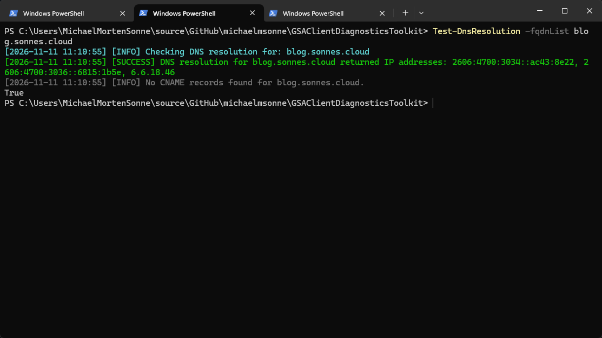

---

### `Test-GSATenantInternetDnsResolution`

Validates tenant Internet forwarding hostnames from the local ForwardingProfile (`tenantId`) and checks for local hosts-file DNS overrides by comparing system resolution with direct DNS (`-NoHostsFile`).

```powershell
Test-GSATenantInternetDnsResolution [-RegistryValueName <string>] [-LogLevel <string>]
```

| Parameter | Default | Description |
|---|---|---|
| `RegistryValueName` | `ForwardingProfile` | Registry value containing the forwarding profile JSON |
| `LogLevel` | Current module level | Optional per-call log verbosity override |

<details>
<summary>Sample output</summary>

```text
PS> Test-GSATenantInternetDnsResolution
[2026-10-14 21:45:00] [INFO] Checking tenant Internet forwarding DNS hostnames for local override issues...
[2026-10-14 21:45:00] [INFO] Validating tenant hostname 'aaaaaaaa-bbbb-cccc-dddd-eeeeeeeeeeee.internet.client.globalsecureaccess.microsoft.com'...
[2026-10-14 21:45:00] [INFO] Direct DNS (NoHostsFile): 6.6.0.12
[2026-10-14 21:45:00] [INFO] System DNS: 6.6.0.12
[2026-10-14 21:45:00] [INFO] CNAME/alias targets: ztna3p-0001.ztna3p-msedge.net -> ztna3p-ring.ztna3p-0001.ztna3p-msedge.net
[2026-10-14 21:45:00] [SUCCESS] System DNS returned expected synthetic GSA address(es): 6.6.0.12.
[2026-10-14 21:45:00] [SUCCESS] Tenant Internet forwarding DNS hostnames resolve to real DNS addresses with no hosts-file override detected.
```

</details>

<!-- TODO: Add screenshot -->
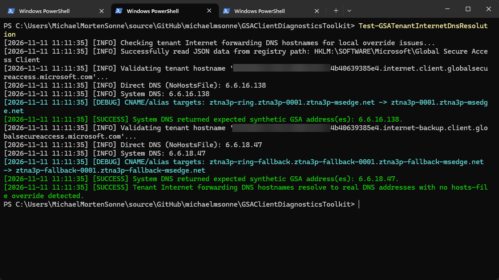

---

### `Test-TLSConnection`

Tests TLS (HTTPS) connectivity to each FQDN on port 443 and logs certificate details at DEBUG level.

```powershell
Test-TLSConnection -fqdnList <string[]> [-port <int>] [-LogLevel <string>]
```

<details>
<summary>Sample output</summary>

```text
PS> Test-TLSConnection -fqdnList edge1.mec.gsaservice.net
[2026-08-20 17:01:00] [INFO] Checking connection to: edge1.mec.gsaservice.net on port 443
[2026-08-20 17:01:00] [SUCCESS] TCP connection successful to edge1.mec.gsaservice.net
[2026-08-20 17:01:00] [SUCCESS] TLS handshake successful with edge1.mec.gsaservice.net
```

</details>

<!-- TODO: Add screenshot -->
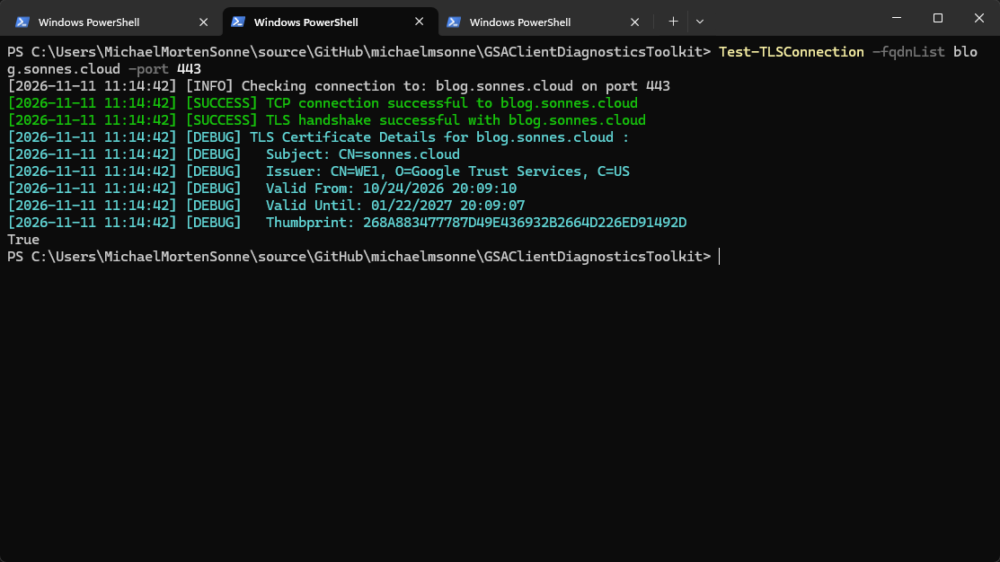

---

### `Test-mTLSConnectivity`

Tests mTLS connectivity using GSA client certificates from the LocalMachine certificate store.

> Run as Administrator for full access to certificate private keys.

```powershell
Test-mTLSConnectivity -fqdnList <string[]> [-port <int>] [-LogLevel <string>]
```

<details>
<summary>Sample output</summary>

```text
PS> Test-mTLSConnectivity -fqdnList edge1.mec.gsaservice.net
[2026-08-20 17:02:00] [SUCCESS] Found 1 mTLS-capable GSA client certificate(s).
[2026-08-20 17:02:00] [INFO] Attempting mTLS connection to: edge1.mec.gsaservice.net on port 443
[2026-08-20 17:02:00] [SUCCESS] TCP connection successful to edge1.mec.gsaservice.net
[2026-08-20 17:02:00] [SUCCESS] mTLS handshake succeeded for edge1.mec.gsaservice.net with certificate CN=0415ab43-xxxx-xxxx-xxxx-4b40639385e4.tenant.gsa.client mTLS: True
```

</details>

<!-- TODO: Add screenshot -->
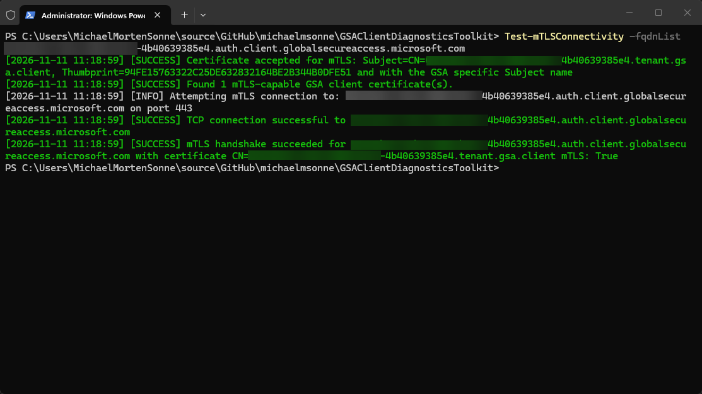

---

### `Test-GSAAuthCertificate`

Checks whether a valid GSA mTLS authentication certificate (subject ending in `gsa.client`) exists in the LocalMachine\My certificate store and hasn't expired. Mirrors the client's built-in "Authentication certificate exists"/"Authentication certificate is valid" Health check tests. This test only applies to tenants with mTLS enabled - if mTLS isn't enabled, no certificate is expected.

```powershell
Test-GSAAuthCertificate [-PassThru] [-LogLevel <string>]
```

| Parameter | Default | Description |
|---|---|---|
| `PassThru` | Off | Return the `$true`/`$false` test result instead of just logging it |

<details>
<summary>Sample output</summary>

```text
[2026-08-20 17:10:02] [INFO] Checking for a GSA mTLS authentication certificate (subject ending in 'gsa.client')...
[2026-08-20 17:10:02] [SUCCESS] Certificate 'CN=0415ab43-xxxx-xxxx-xxxx-4b40639385e4.tenant.gsa.client' (Thumbprint: 169AC0E6CFF0E1F96B444955F781308CF7285FA4) is present and valid until 08/20/2027 17:10:02.
```

</details>

<!-- TODO: Add screenshot -->
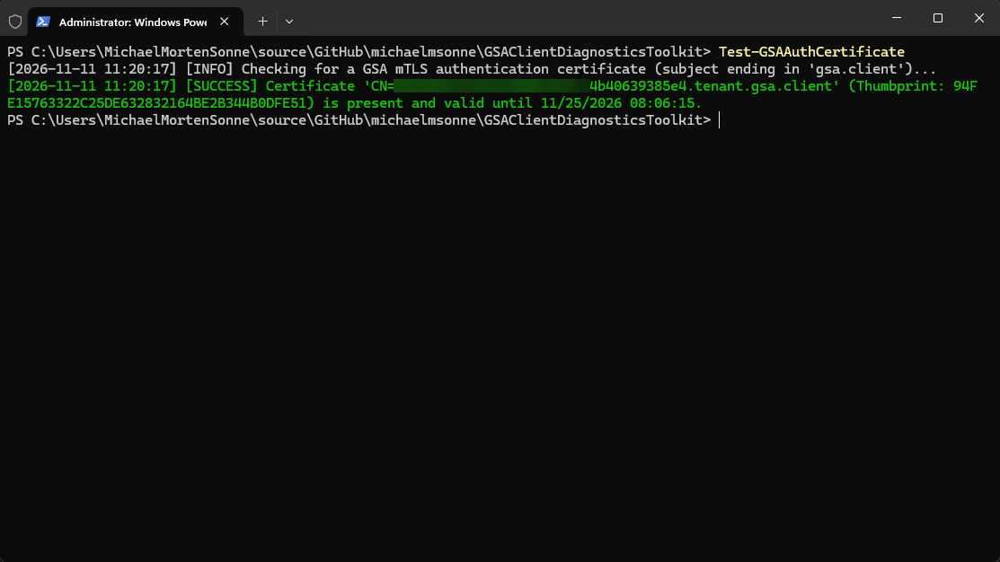

---

### `Export-GSAAuthCertificate`

Exports (backs up) the GSA mTLS authentication certificate(s) - as a password-protected `.pfx` with the private key when exportable, otherwise a public-key-only `.cer` - without modifying or deleting anything. Read-only/non-destructive; use it to back up the certificate independently, or it's called automatically by `Repair-GSAAuthCertificate` before any deletion.

```powershell
Export-GSAAuthCertificate [-BackupPath <string>] [-PassThru] [-LogLevel <string>] [-WhatIf] [-Confirm]
```

| Parameter | Default | Description |
|---|---|---|
| `BackupPath` | Current directory | Directory to export the certificate backup(s) to |
| `PassThru` | Off | Return the exported file path(s) instead of just logging them |

<details>
<summary>Sample output</summary>

```text
PS> Export-GSAAuthCertificate -BackupPath C:\Temp\GSACertBackup
[2026-08-20 17:03:00] [INFO] Found GSA authentication certificate 'CN=0415ab43-xxxx-xxxx-xxxx-4b40639385e4.tenant.gsa.client' (Thumbprint: 169AC0E6CFF0E1F96B444955F781308CF7285FA4).
[2026-08-20 17:03:05] [SUCCESS] Exported certificate (with private key) to: C:\Temp\GSACertBackup\169AC0E6CFF0E1F96B444955F781308CF7285FA4.pfx
```

</details>

<!-- TODO: Add screenshot -->
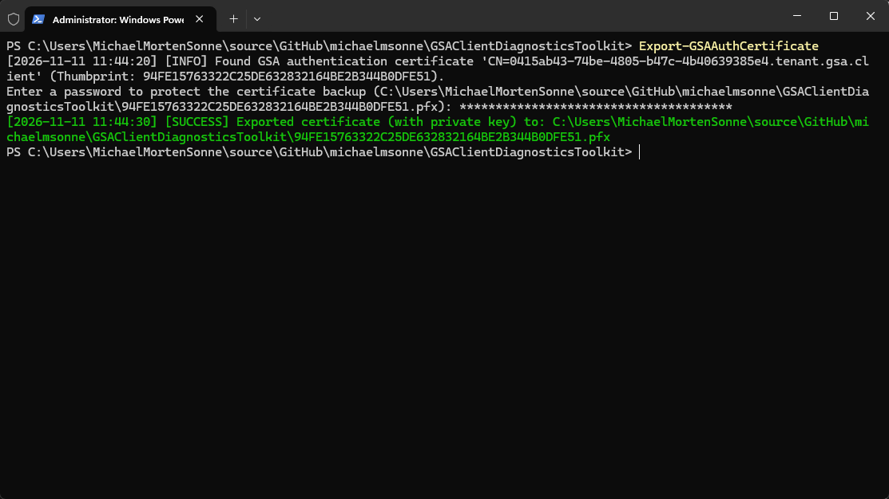

---

### `Repair-GSAAuthCertificate`

Backs up (via `Export-GSAAuthCertificate`) and removes the GSA mTLS authentication certificate so the client re-enrolls a new one - the documented fix when `Test-GSAAuthCertificate` fails. Requires **two separate confirmations** before deleting anything: the standard `-WhatIf`/`-Confirm` prompt, plus typing the certificate's exact thumbprint. Also clears the `CertCommonName` registry value so a new certificate is re-provisioned.

> [!WARNING]
> This is a destructive operation. Requires an elevated (Administrator) PowerShell session. Run `Repair-GSAAuthCertificate -WhatIf` first to preview what would happen.

```powershell
Repair-GSAAuthCertificate [-BackupPath <string>] [-RestartEngineService] [-PassThru] [-LogLevel <string>] [-WhatIf] [-Confirm]
```

| Parameter | Default | Description |
|---|---|---|
| `BackupPath` | Current directory | Directory to export the certificate backup(s) to before deletion |
| `RestartEngineService` | Off | Restart `GlobalSecureAccessEngineService` afterwards so a new certificate is provisioned immediately |
| `PassThru` | Off | Return the `$true`/`$false` result instead of just logging it |

<details>
<summary>Sample output (-WhatIf)</summary>

```text
PS> Repair-GSAAuthCertificate -WhatIf
[2026-08-20 17:52:52] [INFO] Backing up the certificate(s) before making any changes...
[2026-08-20 17:52:52] [INFO] Found GSA authentication certificate 'CN=0415ab43-xxxx-xxxx-xxxx-4b40639385e4.tenant.gsa.client' (Thumbprint: 169AC0E6CFF0E1F96B444955F781308CF7285FA4).
What if: Performing the operation "Export to ...169AC0E6CFF0E1F96B444955F781308CF7285FA4.pfx" on target "169AC0E6CFF0E1F96B444955F781308CF7285FA4 (with private key)".
[2026-08-20 17:52:52] [ERROR] Skipping deletion of '169AC0E6CFF0E1F96B444955F781308CF7285FA4' because a backup could not be created.
What if: Performing the operation "Remove registry value" on target "HKLM:\SOFTWARE\Microsoft\Global Secure Access Client\CertCommonName".
[2026-08-20 17:52:52] [WARNING] Recommended action: Restart the 'GlobalSecureAccessEngineService' service (or re-run with -RestartEngineService) so a new certificate is provisioned.
```

</details>

<!-- TODO: Add screenshot -->
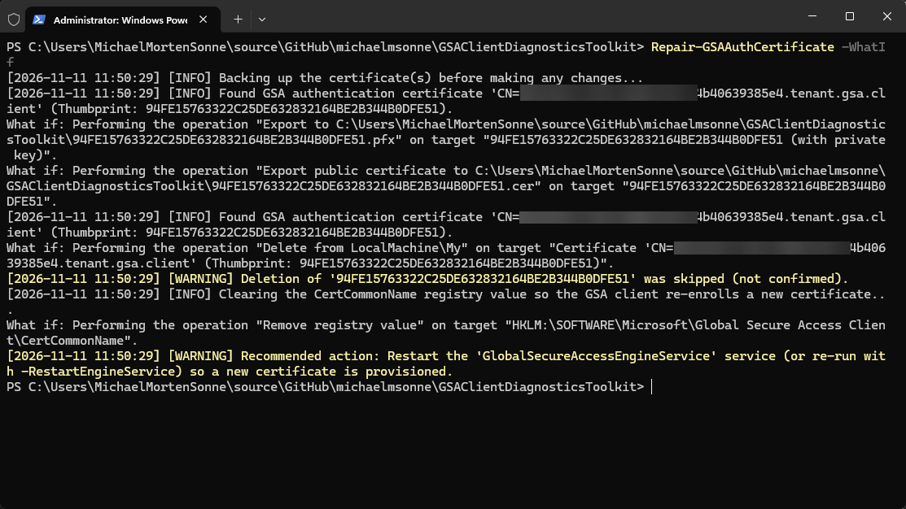

---

### `Test-EntraIDConnectivity`

Tests network reachability of Entra ID endpoints.

```powershell
Test-EntraIDConnectivity [-Endpoints <string[]>] [-Timeout <int>] [-LogLevel <string>]
```

| Parameter | Default | Description |
|---|---|---|
| `Endpoints` | Core Entra ID/Graph/device-registration URLs | Entra ID endpoint URLs to test |
| `Timeout` | `15` | HTTP request timeout in seconds |

<details>
<summary>Sample output</summary>

```text
[2026-08-20 17:04:00] [INFO] Testing connectivity to https://login.microsoftonline.com ...
[2026-08-20 17:04:00] [SUCCESS] Successfully connected to https://login.microsoftonline.com
[2026-08-20 17:04:00] [INFO] Testing connectivity to https://graph.microsoft.com ...
[2026-08-20 17:04:00] [SUCCESS] Successfully connected to https://graph.microsoft.com
```

</details>

<!-- TODO: Add screenshot -->
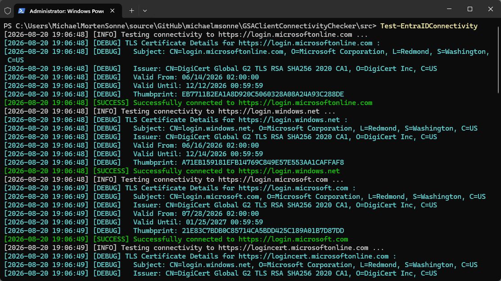

---

### `Test-EntraIDUserAuthentication`

Performs an interactive MSAL token acquisition against Entra ID. Requires the `MSAL.PS` module.

```powershell
Install-Module MSAL.PS
Test-EntraIDUserAuthentication
```

<details>
<summary>Sample output</summary>

```text
[2026-08-20 17:05:00] [INFO] Attempting authentication to Entra ID
[2026-08-20 17:05:04] [INFO] Authentication successful. Token retrieved.
```

</details>

<!-- TODO: Add screenshot -->


---

### `Test-GSADiagnosticUriConnectivity`

Tests connectivity to the GSA per-channel diagnostic URIs extracted from the forwarding profile.

```powershell
Test-GSADiagnosticUriConnectivity -DiagnosticUris <string[]> [-LogLevel <string>]
```

<details>
<summary>Sample output</summary>

```text
PS> Test-GSADiagnosticUriConnectivity -DiagnosticUris https://edgediagnostic.globalsecureaccess.microsoft.com/m365
[2026-08-20 17:06:00] [SUCCESS] DiagnosticUrl test https://edgediagnostic.globalsecureaccess.microsoft.com/m365 succeeded. RTT: 42.13 ms
```

</details>

<!-- TODO: Add screenshot -->
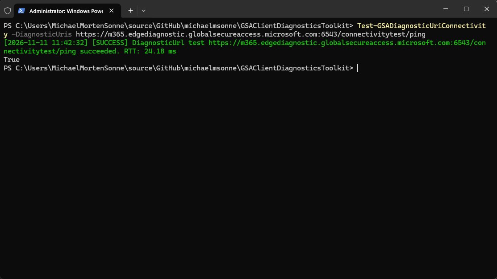

---

### `Test-GSASyntheticRoutes`

Verifies that expected synthetic routes injected by the GSA tunnel are present in the routing table.

```powershell
Test-GSASyntheticRoutes [-LogLevel <string>]
```

<details>
<summary>Sample output</summary>

```text
[2026-08-20 17:07:00] [INFO] Checking for GSA synthetic IP routes (6.6.x.x) in the routing table...
[2026-08-20 17:07:00] [SUCCESS] Found 2 GSA synthetic route(s) - tunnel is active and routing traffic.
```

</details>

<!-- TODO: Add screenshot -->


---

### `Test-GSAPrivateDnsResolver`

Tests whether the GSA Private DNS Resolver is active and responding.

```powershell
Test-GSAPrivateDnsResolver [-LogLevel <string>]
```

<details>
<summary>Sample output</summary>

```text
[2026-08-20 17:08:00] [INFO] Querying GSA Private DNS resolver (6.6.255.254) via TCP...
[2026-08-20 17:08:00] [SUCCESS] GSA Private DNS resolver (6.6.255.254) responded - Private Access tunnel is active.
```

</details>

<!-- TODO: Add screenshot -->
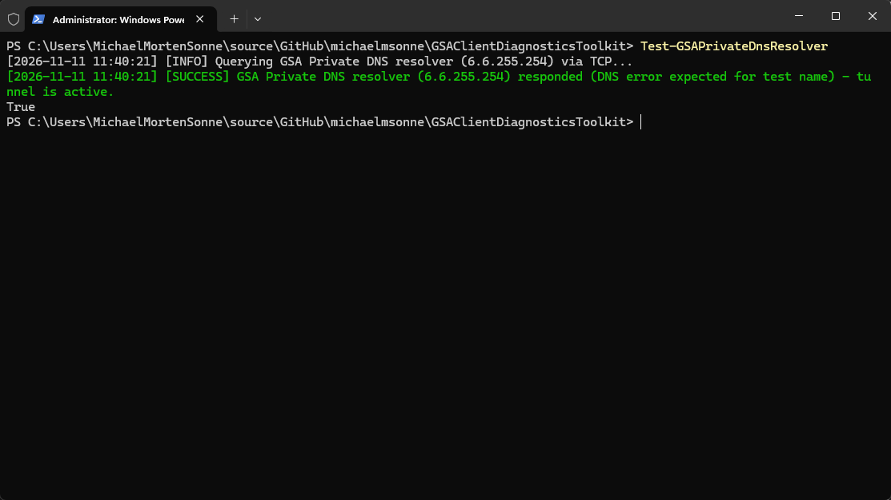

---

### `Test-GSAVpnSplitDnsInteroperability`

Detects a known interoperability scenario where Cisco VPN split-DNS overlaps with GSA private DNS/NRPT for the same suffix and DNS lookups fail with `REFUSED`.

This local check looks for:
- An active Cisco VPN adapter
- An NRPT rule matching the target suffix
- A probe lookup under that suffix returning `REFUSED`

If detected, it logs a recommendation to allow source `6.6.0.0/16` in Cisco split-DNS/extended ACL source networks.

```powershell
Test-GSAVpnSplitDnsInteroperability -DnsSuffix <string> [-ProbeHostLabel <string>] [-CiscoAdapterPattern <string>] [-PassThru] [-LogLevel <string>]
```

| Parameter | Default | Description |
|---|---|---|
| `DnsSuffix` | *(required)* | DNS suffix/domain to test (for example `mydomain.com`) |
| `ProbeHostLabel` | `_gsa_vpn_interop_probe` | Label used to build a probe FQDN under `DnsSuffix` |
| `CiscoAdapterPattern` | `Cisco AnyConnect\|Cisco Secure Client` | Regex used to identify Cisco adapters by name/description |
| `PassThru` | Off | Store the `$true`/`$false` result for orchestration without emitting boolean pipeline output |
| `LogLevel` | Current module level | Optional per-call log verbosity override |

<details>
<summary>Sample output (REFUSED detected)</summary>

```text
PS> Test-GSAVpnSplitDnsInteroperability -DnsSuffix mydomain.com
[2026-10-09 12:00:00] [INFO] Checking Cisco VPN + GSA split-DNS interoperability for suffix 'mydomain.com'...
[2026-10-09 12:00:00] [INFO] Detected active Cisco VPN adapter(s): Cisco Secure Client.
[2026-10-09 12:00:00] [INFO] Found 1 NRPT rule(s) matching 'mydomain.com'.
[2026-10-09 12:00:00] [ERROR] DNS lookup for '_gsa_vpn_interop_probe.mydomain.com' failed with REFUSED while Cisco VPN and matching NRPT rule(s) are active.
[2026-10-09 12:00:00] [WARNING] Recommended action: In Cisco VPN split-DNS + extended ACL, add source network 6.6.0.0/16 so these DNS queries are allowed.
```

</details>

<!-- TODO: Add screenshot -->
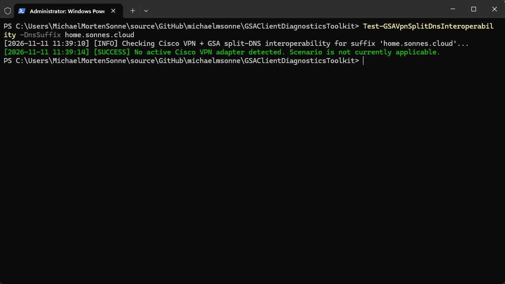

No split tunnel found
---

### `Test-GSAPrivateAccessRule`

Checks whether the locally cached forwarding profile's Private Access rules permit a given target FQDN/IP, port, and protocol - mirroring the client-side rule matching the GSA client performs itself. This is a fully local/offline check (registry only); it does not call Microsoft Graph or require sign-in. By default nothing is returned (only logged); pass `-PassThru` to get the `$true`/`$false` result back for scripting.

```powershell
Test-GSAPrivateAccessRule -FQDNorIP <string> -Port <int> -Protocol <TCP|UDP> [-RegistryValueName <string>] [-PassThru] [-LogLevel <string>]
```

| Parameter | Default | Description |
|---|---|---|
| `FQDNorIP` | *(required)* | Target FQDN or IPv4 address to test |
| `Port` | *(required)* | Target TCP/UDP port number |
| `Protocol` | *(required)* | `TCP` or `UDP` |
| `RegistryValueName` | `ForwardingProfile` | Registry value containing the GSA JSON policy |
| `PassThru` | Off | Return the `$true`/`$false` test result instead of just logging it |

<details>
<summary>Sample output (pass and fail)</summary>

```text
PS> Test-GSAPrivateAccessRule -FQDNorIP homevault.home.sonnes.cloud -Port 445 -Protocol TCP
[2026-08-20 15:45:53] [INFO] Checking Private Access rules in the local forwarding profile for homevault.home.sonnes.cloud:445/TCP...
[2026-08-20 15:45:53] [INFO] Successfully read JSON data from registry path: HKLM:\SOFTWARE\Microsoft\Global Secure Access Client
[2026-08-20 15:45:53] [SUCCESS] 'homevault.home.sonnes.cloud' is covered by rule 'c418cabb-18c0-45bc-9202-8848ad37c0ac' (App ID: 5c3b2f7c-64fa-4d4f-aa39-1807c82db702).
[2026-08-20 15:45:53] [SUCCESS] Port 445 is configured for the matching Private Access application.
[2026-08-20 15:45:53] [SUCCESS] Test passed: 'homevault.home.sonnes.cloud' on port 445/TCP is allowed by the local Private Access forwarding profile (Rule ID: c418cabb-18c0-45bc-9202-8848ad37c0ac, App ID: 5c3b2f7c-64fa-4d4f-aa39-1807c82db702).

PS> Test-GSAPrivateAccessRule -FQDNorIP homevault.home.sonnes.cloud -Port 444 -Protocol TCP
[2026-08-20 15:46:09] [INFO] Checking Private Access rules in the local forwarding profile for homevault.home.sonnes.cloud:444/TCP...
[2026-08-20 15:46:09] [INFO] Successfully read JSON data from registry path: HKLM:\SOFTWARE\Microsoft\Global Secure Access Client
[2026-08-20 15:46:09] [SUCCESS] 'homevault.home.sonnes.cloud' is covered by rule '4e7c99e2-1a17-4529-b7d6-5f74295b90b7' (App ID: 5c3b2f7c-64fa-4d4f-aa39-1807c82db702).
[2026-08-20 15:46:09] [ERROR] Port 444 is NOT configured for the matching Private Access application (App ID: 5c3b2f7c-64fa-4d4f-aa39-1807c82db702).
[2026-08-20 15:46:09] [WARNING] Recommended action: Add port 444 to the application segment for App ID: 5c3b2f7c-64fa-4d4f-aa39-1807c82db702.
```

</details>

<!-- TODO: Add screenshot -->
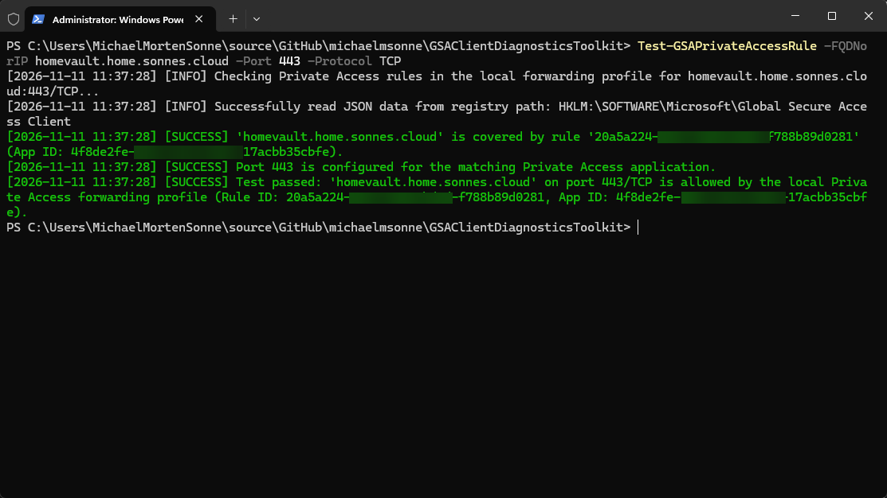

---

### `Test-GSAPrivateAccessTunnel`

Opens a live TCP connection to the target FQDN/IP and port to verify traffic is actually tunneled through GSA. For FQDN targets, confirms the connection resolved to a synthetic `6.6.x.x` address and resolves the internal address via the GSA Private DNS resolver (`6.6.255.254`). UDP targets cannot be tunnel-tested this way and are reported as a warning only. By default nothing is returned (only logged); pass `-PassThru` to get the `$true`/`$false` result back for scripting.

```powershell
Test-GSAPrivateAccessTunnel -FQDNorIP <string> -Port <int> -Protocol <TCP|UDP> [-PassThru] [-LogLevel <string>]
```

<details>
<summary>Sample output</summary>

```text
PS> Test-GSAPrivateAccessTunnel -FQDNorIP fileserver.contoso.com -Port 445 -Protocol TCP
[2026-08-20 17:09:00] [INFO] Checking Private Access tunnel connectivity to fileserver.contoso.com:445...
[2026-08-20 17:09:00] [SUCCESS] Tunnel connection established. Synthetic address: 6.6.0.12
[2026-08-20 17:09:00] [SUCCESS] Internal address for fileserver.contoso.com resolved via GSA Private DNS: 10.0.0.42
[2026-08-20 17:09:00] [SUCCESS] Test passed: tunnel to fileserver.contoso.com on port 445 established successfully via GSA (synthetic address: 6.6.0.12).
```

</details>

<!-- TODO: Add screenshot -->
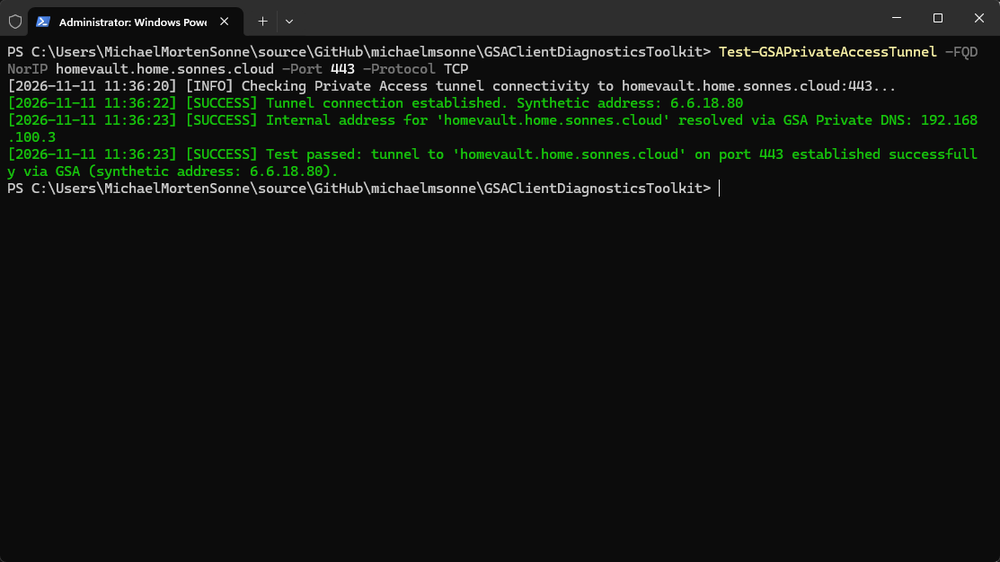

---

### `Test-GSAClientProfileConnectivity`

Confirms the locally cached forwarding profile contains a channel for the requested profile type(s) (`m365`/`private`/`internet`), tests TCP connectivity to each channel's primary edge (falling back to the secondary edge), and confirms each channel's diagnostic endpoint responds with HTTP 200 and body `pong`. This is a fully local/offline check; it does not call Microsoft Graph.

```powershell
Test-GSAClientProfileConnectivity [-ProfileType <m365|private|internet>[,...]] [-RegistryValueName <string>] [-PassThru] [-LogLevel <string>]
```

| Parameter | Default | Description |
|---|---|---|
| `ProfileType` | All three (`m365`, `private`, `internet`) | One or more of `m365`, `private`, `internet` to test |
| `RegistryValueName` | `ForwardingProfile` | Registry value containing the GSA JSON policy |
| `PassThru` | Off | Return the combined `$true`/`$false` test result (across all tested profiles) instead of just logging it |

<details>
<summary>Sample output</summary>

```text
[2026-08-20 17:11:00] [INFO] Checking Private Access profile...
[2026-08-20 17:11:00] [SUCCESS] Private Access forwarding profile configuration has been retrieved.
[2026-08-20 17:11:00] [INFO] Checking connectivity to Private Access edge...
[2026-08-20 17:11:00] [SUCCESS] Connection to the Private Access primary edge (edge1.mec.gsaservice.net:443) succeeded.
[2026-08-20 17:11:00] [INFO] Checking connectivity to the Private Access diagnostic endpoint...
[2026-08-20 17:11:01] [SUCCESS] Connection to the Private Access diagnostic endpoint succeeded.
```

</details>

<!-- TODO: Add screenshot -->
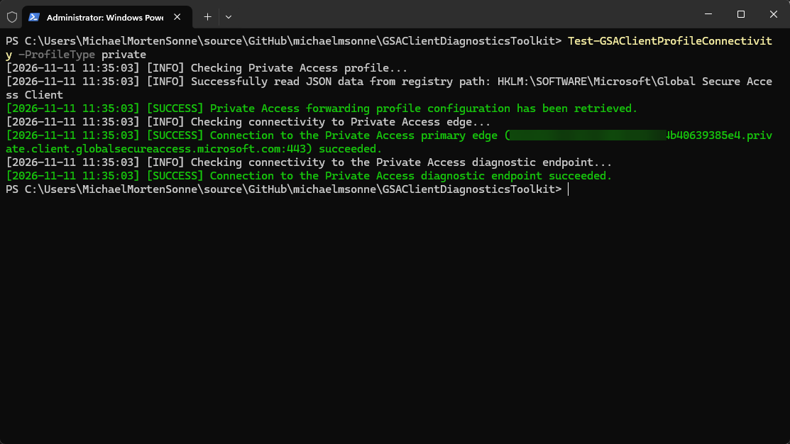

---

> The three functions below call Microsoft Graph. Pass an access token via `-AccessToken` (e.g. acquired via `Test-EntraIDUserAuthentication`/`MSAL.PS`, or your own Graph sign-in) with the `NetworkAccess.Read.All`, `Application.Read.All`, `Directory.Read.All`, and `User.Read.All` delegated permissions. If you omit `-AccessToken`, the module automatically prompts an interactive sign-in via `Connect-MgGraph` (requires the `Microsoft.Graph.Authentication` module) and reuses any already-active Graph session for subsequent calls, so you're only prompted once per session.

### `Test-GSAForwardingProfileAssignment`

Checks via Microsoft Graph that the tenant is onboarded to Global Secure Access, that the requested forwarding profile (`m365`/`private`/`internet`) is enabled, and that the target user is assigned - directly or via group membership - to that profile's enterprise application.

```powershell
Test-GSAForwardingProfileAssignment [-AccessToken <string>] -ProfileType <m365|private|internet> [-UserPrincipalName <string>] [-PassThru] [-LogLevel <string>]
```

| Parameter | Default | Description |
|---|---|---|
| `AccessToken` | Prompts `Connect-MgGraph` sign-in | Microsoft Graph access token |
| `ProfileType` | *(required)* | `m365`, `private`, or `internet` |
| `UserPrincipalName` | Current signed-in user (`whoami /upn`) | UPN of the user to check assignment for |
| `PassThru` | Off | Return the `$true`/`$false` test result instead of just logging it |

<details>
<summary>Sample output</summary>

```text
[2026-08-20 16:52:52] [INFO] Checking the Global Secure Access activation status...
[2026-08-20 16:52:52] [SUCCESS] Global Secure Access is activated in the tenant.
[2026-08-20 16:52:52] [INFO] Checking the Microsoft Traffic forwarding profile...
[2026-08-20 16:52:55] [SUCCESS] Microsoft Traffic forwarding profile is enabled.
[2026-08-20 16:52:55] [INFO] Checking user assignment to the Microsoft Traffic forwarding profile...
[2026-08-20 16:52:56] [SUCCESS] 'michael@sonnes.cloud' is assigned to the Microsoft Traffic profile.
```

</details>

<!-- TODO: Add screenshot -->
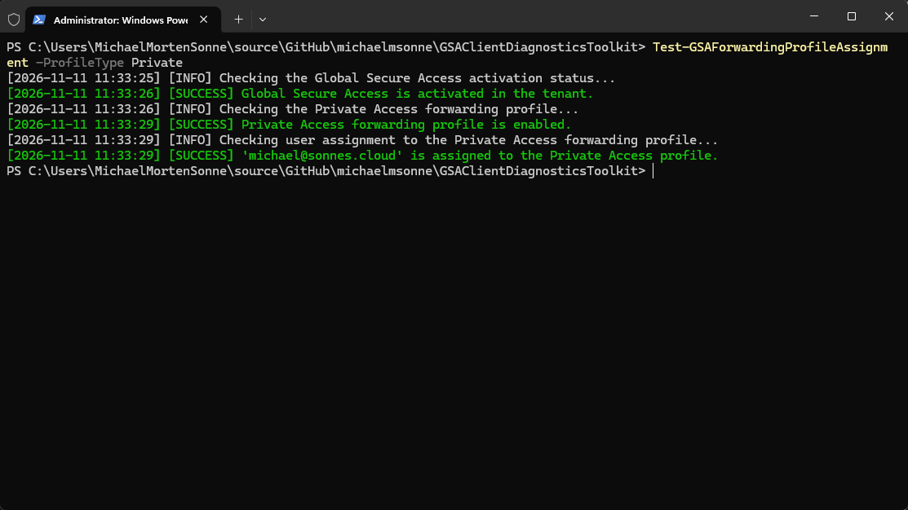

---

### `Test-GSAPrivateAccessApplicationSegment`

Checks via Microsoft Graph that a Private Access application is enabled, the user is assigned, and the target FQDN/IP + port + protocol is covered by one of its application segments.

```powershell
Test-GSAPrivateAccessApplicationSegment [-AccessToken <string>] -AppId <string> -FQDNorIP <string> -Port <int> -Protocol <TCP|UDP> [-UserPrincipalName <string>] [-PassThru] [-LogLevel <string>]
```

| Parameter | Default | Description |
|---|---|---|
| `AccessToken` | Prompts `Connect-MgGraph` sign-in | Microsoft Graph access token |
| `AppId` | *(required)* | The Private Access application's (client) App ID |
| `FQDNorIP` | *(required)* | Target FQDN or IPv4 address to test |
| `Port` | *(required)* | Target TCP/UDP port number |
| `Protocol` | *(required)* | `TCP` or `UDP` |
| `UserPrincipalName` | Current signed-in user (`whoami /upn`) | UPN of the user to check assignment for |
| `PassThru` | Off | Return the `$true`/`$false` test result instead of just logging it |

<details>
<summary>Sample output</summary>

```text
PS> Test-GSAPrivateAccessApplicationSegment -AppId 5c3b2f7c-64fa-4d4f-aa39-1807c82db702 -FQDNorIP fileserver.contoso.com -Port 445 -Protocol TCP
[2026-08-20 17:12:00] [INFO] Checking Private Access application status...
[2026-08-20 17:12:00] [SUCCESS] Private Access application (App ID: 5c3b2f7c-64fa-4d4f-aa39-1807c82db702) is enabled.
[2026-08-20 17:12:00] [INFO] Checking Private Access application user assignment...
[2026-08-20 17:12:01] [SUCCESS] 'user@contoso.com' is assigned to the Private Access application (App ID: 5c3b2f7c-64fa-4d4f-aa39-1807c82db702).
[2026-08-20 17:12:01] [SUCCESS] Test passed: 'fileserver.contoso.com' on port 445/TCP is configured for the Private Access application (App ID: 5c3b2f7c-64fa-4d4f-aa39-1807c82db702).
```

</details>

<!-- TODO: Add screenshot -->
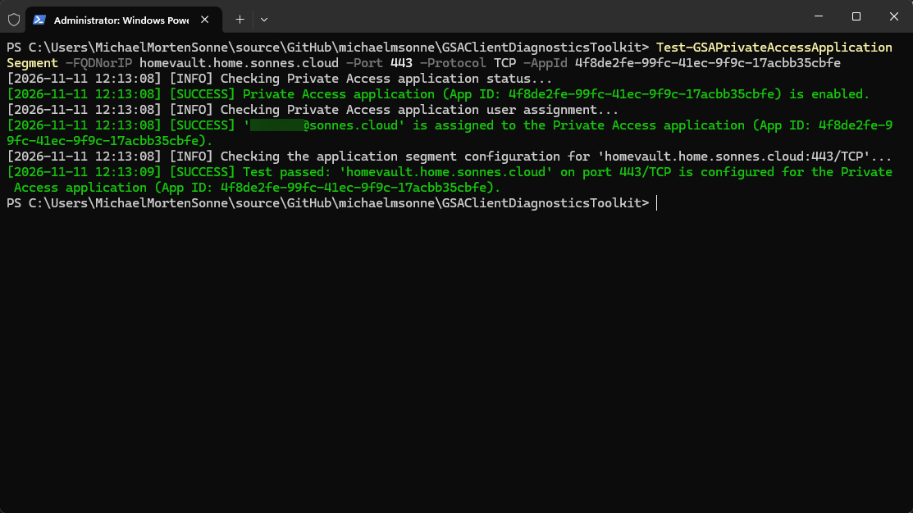

---

### `Test-GSAPrivateAccessApplication`

Full end-to-end Private Access application check: confirms "Enable access with Global Secure Access client" is turned on for the application, runs `Test-GSAPrivateAccessApplicationSegment` to validate the Entra-side configuration, and then runs `Test-GSAPrivateAccessTunnel` to verify the traffic actually tunnels through the GSA client.

```powershell
Test-GSAPrivateAccessApplication [-AccessToken <string>] -AppId <string> -FQDNorIP <string> -Port <int> -Protocol <TCP|UDP> [-UserPrincipalName <string>] [-PassThru] [-LogLevel <string>]
```

| Parameter | Default | Description |
|---|---|---|
| `AccessToken` | Prompts `Connect-MgGraph` sign-in | Microsoft Graph access token |
| `AppId` | *(required)* | The Private Access application's (client) App ID |
| `FQDNorIP` | *(required)* | Target FQDN or IPv4 address to test |
| `Port` | *(required)* | Target TCP/UDP port number |
| `Protocol` | *(required)* | `TCP` or `UDP` |
| `UserPrincipalName` | Current signed-in user (`whoami /upn`) | UPN of the user to check assignment for |
| `PassThru` | Off | Return the `$true`/`$false` test result instead of just logging it |

<details>
<summary>Sample output</summary>

```text
PS> Test-GSAPrivateAccessApplication -AppId 5c3b2f7c-64fa-4d4f-aa39-1807c82db702 -FQDNorIP fileserver.contoso.com -Port 445 -Protocol TCP
[2026-08-20 17:13:00] [INFO] Checking Private Access application configuration...
[2026-08-20 17:13:00] [SUCCESS] Access with Global Secure Access client is enabled for 'FileServer App'.
[2026-08-20 17:13:02] [INFO] Checking tunnel establishment for 'FileServer App'...
[2026-08-20 17:13:02] [SUCCESS] Test passed: Private Access application 'FileServer App' (App ID: 5c3b2f7c-64fa-4d4f-aa39-1807c82db702) is fully configured and reachable for 'fileserver.contoso.com' on port 445/TCP.
```

</details>

<!-- TODO: Add screenshot -->
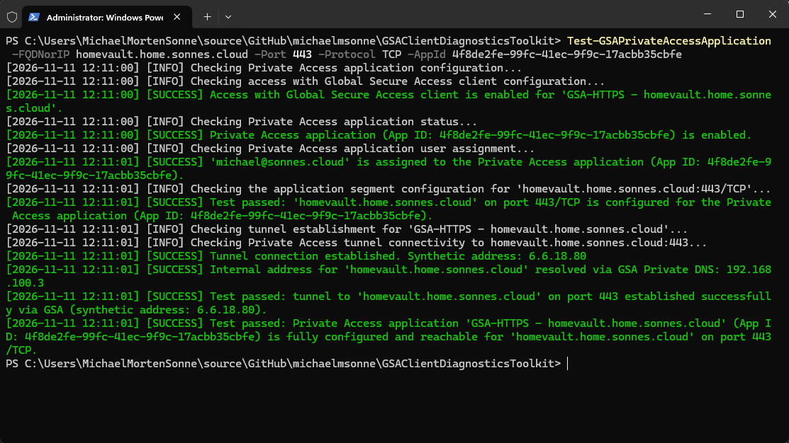

---

### `Test-GSAIntelligentLocalAccessConfiguration`

Checks Intelligent Local Access (ILA) Private Network definitions via Microsoft Graph for a misconfiguration
that can cause GSA to incorrectly bypass Private Access traffic to a local/direct connection when the client
is **not** actually on the expected corporate network. For each Private Network's DNS-based identification, it
flags: a probe FQDN that is publicly resolvable (defeats corporate-network detection), and DNS server/expected
IP addresses that are public rather than private (RFC1918). This mirrors a confirmed real-world root cause
where users on hotel/home networks couldn't reach Private Access resources because ILA's probe FQDN had a
public DNS record and was satisfied from any network. Each Private Network's associated application IDs are
resolved to friendly display names for more actionable logging, and any App ID that no longer resolves to a
known ZTNA/Quick Access application is flagged as possibly stale.

Public resolvability is checked via DNS-over-HTTPS (DoH) rather than a classic port-53 query, since a plain
query can be silently intercepted and answered - either by the GSA client's own WFP driver for any FQDN it
tunnels (returning a synthetic `6.6.x.x` address, which this check detects and reports as inconclusive rather
than a false failure), or by a home/office router with its own local DNS records (e.g. a UniFi "Host (A)"
record) - neither of which reflects what the FQDN actually resolves to on the public internet.

Pass `-FQDN` (optionally with `-DnsServerAddress`/`-ExpectedIPAddress`) to manually check a single candidate
FQDN instead of retrieving Private Network definitions from Microsoft Graph - useful to validate an FQDN
before configuring it as an ILA Private Network in Entra. No Graph call or sign-in is made in this mode.

```powershell
Test-GSAIntelligentLocalAccessConfiguration [-AccessToken <string>] [-PublicDnsServer <string>] [-PassThru] [-LogLevel <string>]
Test-GSAIntelligentLocalAccessConfiguration -FQDN <string> [-DnsServerAddress <string[]>] [-ExpectedIPAddress <string[]>] [-PublicDnsServer <string>] [-PassThru] [-LogLevel <string>]
```

| Parameter | Default | Description |
|---|---|---|
| `AccessToken` | Prompts `Connect-MgGraph` sign-in | Microsoft Graph access token |
| `FQDN` | *(none)* | Manually check a single candidate probe FQDN instead of querying Microsoft Graph |
| `DnsServerAddress` | *(none)* | DNS server address(es) to also validate as private/internal - only used with `-FQDN` |
| `ExpectedIPAddress` | *(none)* | Expected resolved IP address(es) to also validate as private/internal - only used with `-FQDN` |
| `PublicDnsServer` | `https://dns.google/resolve` | DNS-over-HTTPS (DoH) JSON API endpoint used to check whether a probe FQDN is publicly resolvable |
| `PassThru` | Off | Return the `$true`/`$false` test result instead of just logging it |

<details>
<summary>Sample output</summary>

```text
PS> Test-GSAIntelligentLocalAccessConfiguration
[2026-09-09 10:00:00] [INFO] Retrieving Intelligent Local Access Private Network definitions via Microsoft Graph...
[2026-09-09 10:00:01] [INFO] Checking Private Network 'Home sweet home' (target app(s): GSA-HTTPS - unifi.home.sonnes.cloud)...
[2026-09-09 10:00:01] [ERROR] Private Network 'Home sweet home' probe FQDN 'pfsense.contoso.com' is PUBLICLY resolvable via DNS-over-HTTPS (resolves to 20.10.30.40).
[2026-09-09 10:00:01] [WARNING] Recommended action: Use an FQDN that only resolves on your internal/corporate DNS servers (no public DNS record). A publicly resolvable probe FQDN defeats corporate-network detection and can cause GSA to incorrectly bypass Private Access traffic locally for users who are NOT on the corporate network (a confirmed real-world root cause of client connectivity failures on hotel/home networks).

PS> Test-GSAIntelligentLocalAccessConfiguration -FQDN unifi.home.sonnes.cloud
[2026-09-09 23:37:45] [INFO] Manually checking probe FQDN 'unifi.home.sonnes.cloud' for Intelligent Local Access misconfigurations...
[2026-09-09 23:37:45] [SUCCESS] Manual check for 'unifi.home.sonnes.cloud': probe FQDN 'unifi.home.sonnes.cloud' is not publicly resolvable - OK.
[2026-09-09 23:37:45] [SUCCESS] Test passed: No Intelligent Local Access misconfigurations detected for 'unifi.home.sonnes.cloud'.
```

</details>

<!-- TODO: Add screenshot -->
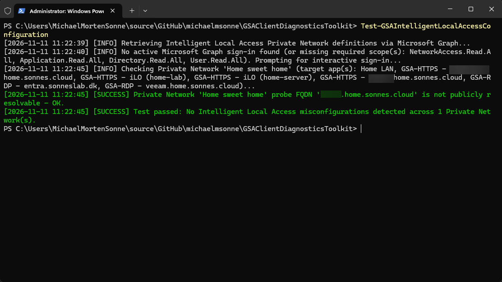


---

### `Test-GSAEventLog`

Reads the GSA event log and reports recent errors and warnings.

```powershell
Test-GSAEventLog [-LogLevel <string>]
```

<details>
<summary>Sample output</summary>

```text
[2026-08-20 17:14:00] [INFO] Scanning GSA event log 'Microsoft-Windows-Global Secure Access Client-Operational' for Critical/Error/Warning events in the last 1 hour(s)...
[2026-08-20 17:14:00] [SUCCESS] No Critical/Error/Warning events found in the GSA event log in the last 1 hour(s).
```

</details>

<!-- TODO: Add screenshot -->
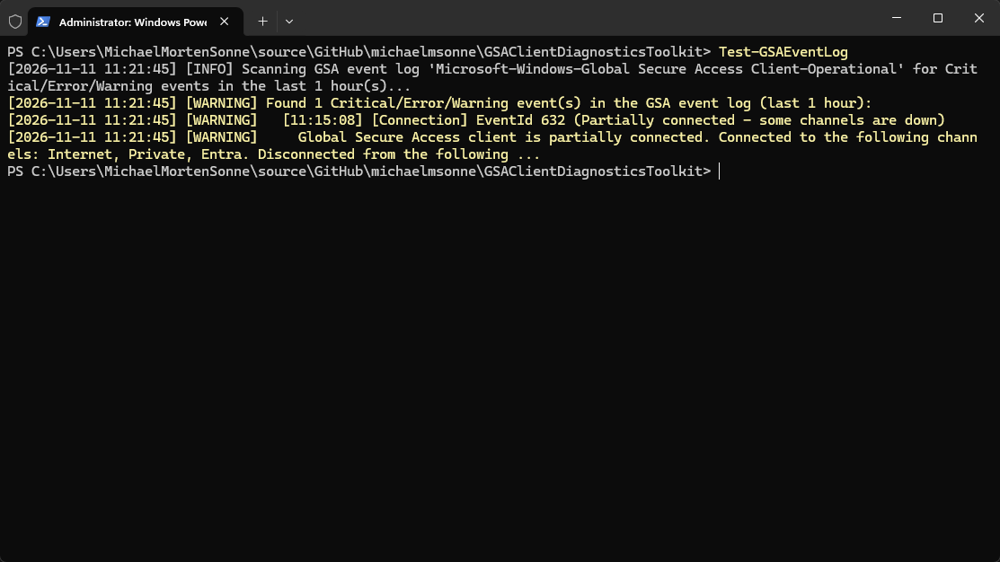

---

## Log Levels

| Level | What is logged |
|---|---|
| `ERROR` | Failures only |
| `WARNING` | Failures and warnings |
| `INFO` | Normal operational messages (default) |
| `SUCCESS` | Successful check confirmations |
| `DEBUG` | Everything, including certificate chains and raw registry values |

---

## Examples

```powershell
# Full check with default INFO logging
Invoke-GSAClientConnectivityCheck

# Full check with DEBUG output saved to C:\Logs
Invoke-GSAClientConnectivityCheck -LogLevel DEBUG -BasePath C:\Logs

# Full check, only log errors and warnings
Invoke-GSAClientConnectivityCheck -LogLevel WARNING

# Run individual checks
Test-GSAServiceStatus
Test-DeviceEntraStatus
Test-mTLSConnectivity -fqdnList (Get-GSAEndpoints).MainEndpoints

# Save the current edge addresses to a file
$endpoints = Get-GSAEndpoints
Export-GSAEdgeAddresses -fqdnList $endpoints.MainEndpoints -filePath C:\Temp\edges.txt

# Check whether a specific Private Access target/port/protocol is allowed locally,
# then verify it actually tunnels through the GSA client
Test-GSAPrivateAccessRule -FQDNorIP fileserver.contoso.com -Port 445 -Protocol TCP
Test-GSAPrivateAccessTunnel -FQDNorIP fileserver.contoso.com -Port 445 -Protocol TCP

# Same checks, but capture the pass/fail result for scripting instead of just logging it
if (Test-GSAPrivateAccessRule -FQDNorIP fileserver.contoso.com -Port 445 -Protocol TCP -PassThru) {
    Write-Host 'Rule allows this target'
}

# Test a specific channel's edge/diagnostic connectivity locally (no sign-in required)
Test-GSAClientProfileConnectivity -ProfileType private

# Or test all three channels (m365, private, internet) at once
Test-GSAClientProfileConnectivity

# Detect Cisco VPN + GSA split-DNS REFUSED scenario for a private suffix
Test-GSAVpnSplitDnsInteroperability -DnsSuffix mydomain.com

# Graph-based checks - by default prompts an interactive Connect-MgGraph sign-in the first time
# (requires the Microsoft.Graph.Authentication module); reuses the session on subsequent calls
Test-GSAForwardingProfileAssignment -ProfileType private
Test-GSAPrivateAccessApplicationSegment -AppId <appId> -FQDNorIP fileserver.contoso.com -Port 445 -Protocol TCP
Test-GSAPrivateAccessApplication -AppId <appId> -FQDNorIP fileserver.contoso.com -Port 445 -Protocol TCP

# Or pass your own access token instead (e.g. via Test-EntraIDUserAuthentication + MSAL.PS)
Install-Module MSAL.PS
$token = (Get-MsalToken -ClientId '<your-client-id>' -Scopes 'https://graph.microsoft.com/.default').AccessToken
Test-GSAForwardingProfileAssignment -AccessToken $token -ProfileType private
```

---

## Star This Project

If `GSAClientDiagnosticsToolkit` helps you troubleshoot Global Secure Access, please consider giving it a star! ⭐

---

## Support

This project is open-source and I invite everybody who can and will to contribute, but I cannot provide any formal support since this was created as a personal/hobby project, with the best intentions in mind. For commercial support, please reach out on LinkedIn so we can discuss the possibilities.

<a href="https://www.buymeacoffee.com/sonnes" target="_blank"></a>

Reach out to the maintainer at one of the following places:

- [GitHub Issues](https://github.com/michaelmsonne/GSAClientDiagnosticsToolkit/issues) - for bugs and feature requests
- [LinkedIn](https://www.linkedin.com/in/michaelmsonne/) - for commercial inquiries
- The email listed on the [GitHub profile](https://github.com/michaelmsonne)

---

## Disclaimer

This module is provided **"AS IS"** without warranty of any kind. It is not supported under any Microsoft standard support program or service. Use at your own risk.

Author: Michael Morten Sonne - [blog.sonnes.cloud](https://blog.sonnes.cloud)